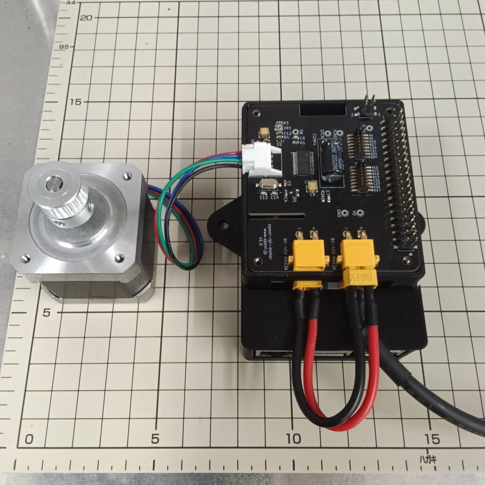

# Openi RPi Motor クイックスタート

Raspberry PiからL6470ステッピングモータードライバーを制御するサンプルプログラムです。

## 概要
Openi RPi モーターを使用します。
https://openi.jp/products/openi-rpi-motor



プログラムを実行すると、次の動作を繰り返します。

1. 右に1回転
2. 0.5秒停止
3. 左に1回転
4. 0.5秒停止

`q`キーを押すと停止し、モーター出力を解放します。

## 必要なもの

- Raspberry Pi
- Openi RPi モーター
- 2相バイポーラステッピングモーター(3A以下)

## セットアップ

### リポジトリを取得

```console
git clone https://github.com/openi-jp/openi-rpi-motor-quickstart
cd openi-rpi-motor-quickstart
```

### SPIを有効化

```console
sudo raspi-config
```

`3 Interface Options` → `I4 SPI` → `Yes` を選択し、再起動します。

```console
sudo reboot
```

### プログラムを実行

```console
python3 main.py
```

## 操作

- `q`: 動作を停止して終了
- `Ctrl+C`: 動作を中断して安全停止

## トラブルシューティング

### `[Errno 22] Invalid argument`

SPIデバイスが有効になっているか確認します。

```console
ls -l /dev/spidev*
python3 -m pip show spidev
```

`/dev/spidev0.0` が存在しない場合は、SPIを有効化して再起動してください。
エラーが続く場合は、表示されたトレースバックで失敗したSPI設定項目を確認してください。

## ライセンス

MIT License
